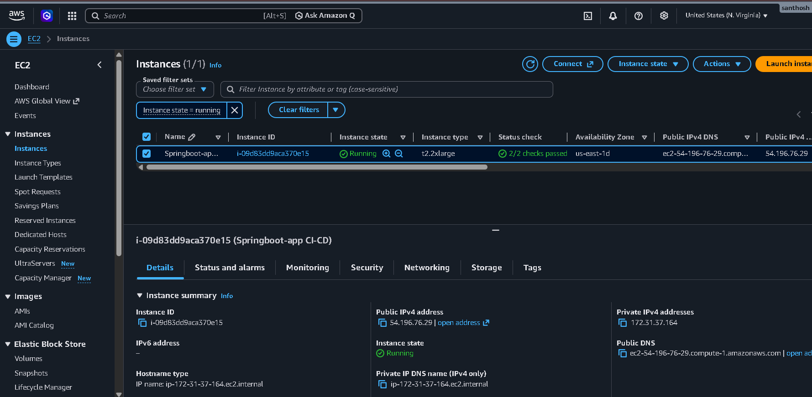
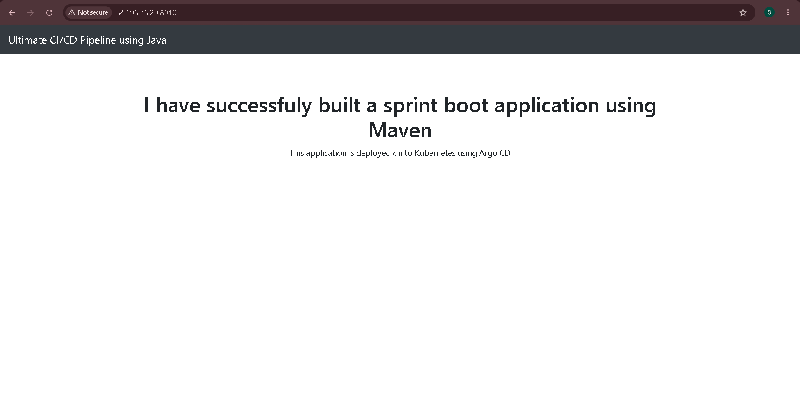
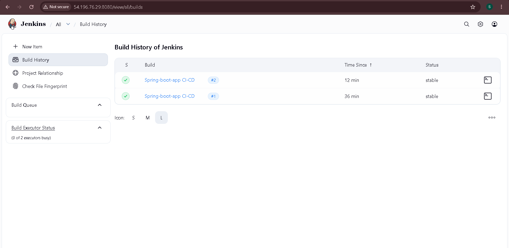
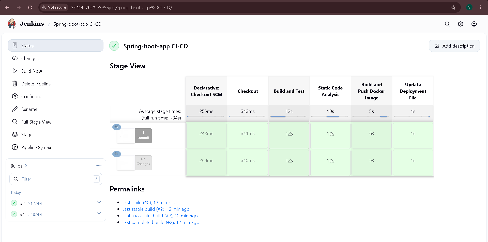
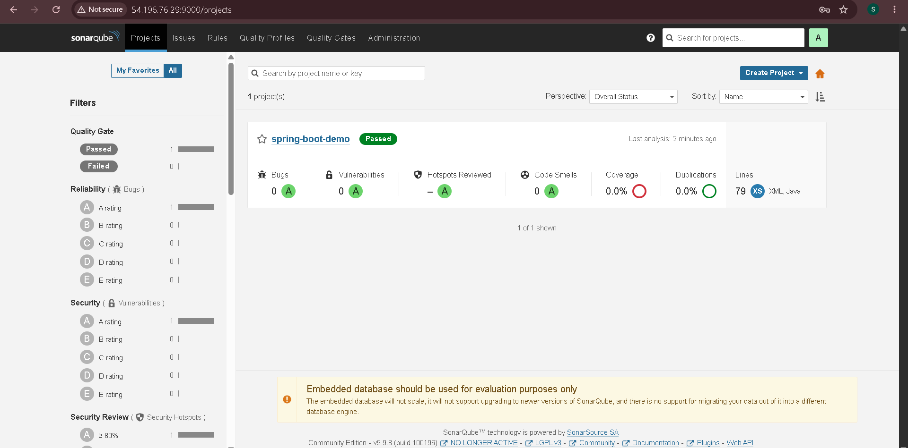
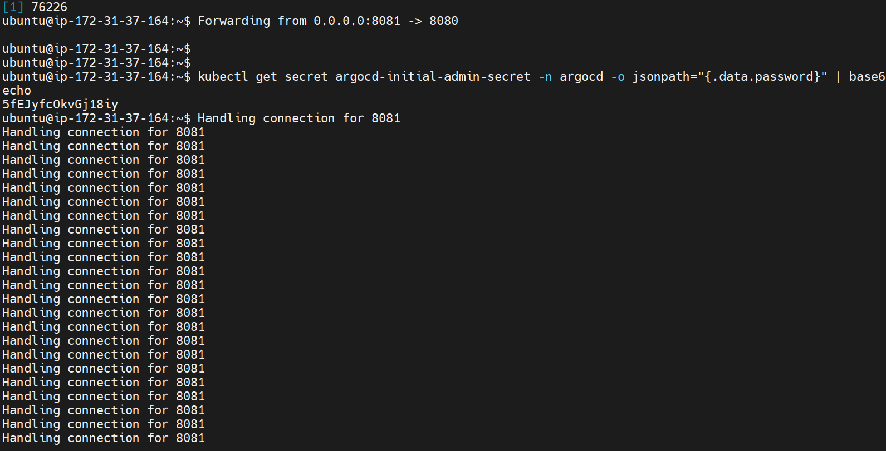
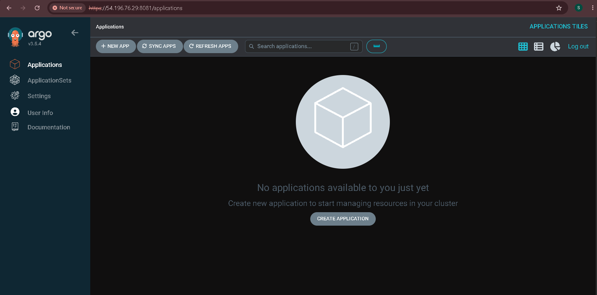
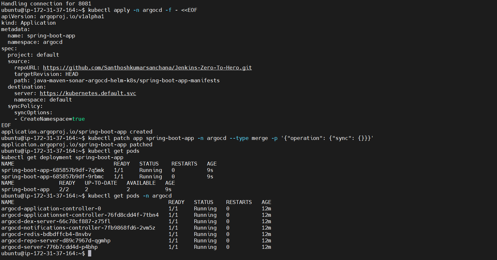
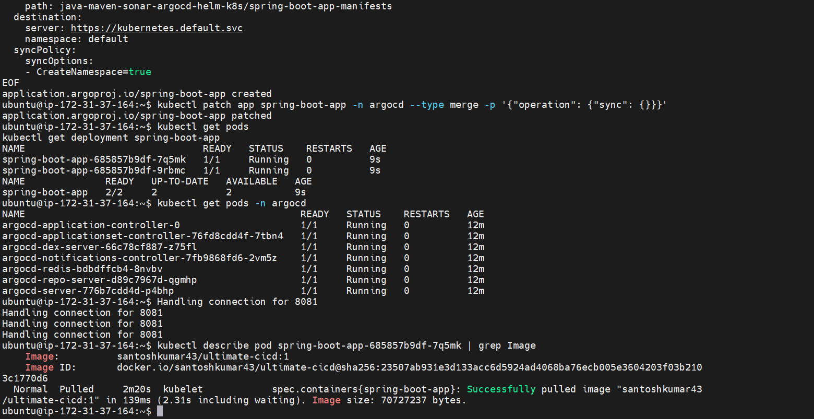
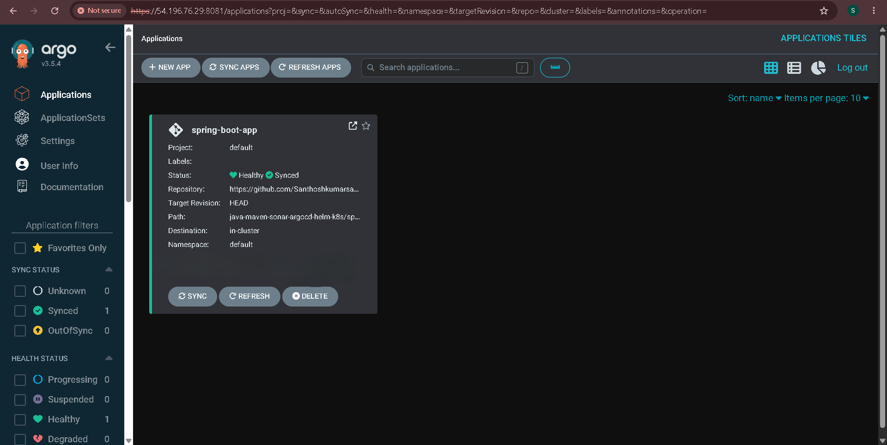

# Jenkins Pipeline for Java based application using Maven, SonarQube, Argo CD, Helm and Kubernetes

Here are the step-by-step details to set up an end-to-end Jenkins pipeline for a Java application using SonarQube, Argo CD, Helm, and Kubernetes:

Prerequisites:

   -  Java application code hosted on a Git repository
   -   Jenkins server
   -  Kubernetes cluster
   -  Helm package manager
   -  Argo CD

Steps:

    1. Install the necessary Jenkins plugins:
       1.1 Git plugin
       1.2 Maven Integration plugin
       1.3 Pipeline plugin
       1.4 Kubernetes Continuous Deploy plugin

    2. Create a new Jenkins pipeline:
       2.1 In Jenkins, create a new pipeline job and configure it with the Git repository URL for the Java application.
       2.2 Add a Jenkinsfile to the Git repository to define the pipeline stages.

    3. Define the pipeline stages:
        Stage 1: Checkout the source code from Git.
        Stage 2: Build the Java application using Maven.
        Stage 3: Run unit tests using JUnit and Mockito.
        Stage 4: Run SonarQube analysis to check the code quality.
        Stage 5: Package the application into a JAR file.
        Stage 6: Deploy the application to a test environment using Helm.
        Stage 7: Run user acceptance tests on the deployed application.
        Stage 8: Promote the application to a production environment using Argo CD.

    4. Configure Jenkins pipeline stages:
        Stage 1: Use the Git plugin to check out the source code from the Git repository.
        Stage 2: Use the Maven Integration plugin to build the Java application.
        Stage 3: Use the JUnit and Mockito plugins to run unit tests.
        Stage 4: Use the SonarQube plugin to analyze the code quality of the Java application.
        Stage 5: Use the Maven Integration plugin to package the application into a JAR file.
        Stage 6: Use the Kubernetes Continuous Deploy plugin to deploy the application to a test environment using Helm.
        Stage 7: Use a testing framework like Selenium to run user acceptance tests on the deployed application.
        Stage 8: Use Argo CD to promote the application to a production environment.

    5. Set up Argo CD:
        Install Argo CD on the Kubernetes cluster.
        Set up a Git repository for Argo CD to track the changes in the Helm charts and Kubernetes manifests.
        Create a Helm chart for the Java application that includes the Kubernetes manifests and Helm values.
        Add the Helm chart to the Git repository that Argo CD is tracking.

    6. Configure Jenkins pipeline to integrate with Argo CD:
       6.1 Add the Argo CD API token to Jenkins credentials.
       6.2 Update the Jenkins pipeline to include the Argo CD deployment stage.

    7. Run the Jenkins pipeline:
       7.1 Trigger the Jenkins pipeline to start the CI/CD process for the Java application.
       7.2 Monitor the pipeline stages and fix any issues that arise.
## Project Walkthrough 

### 1. AWS EC2 Instance
EC2 instance hosting Jenkins, SonarQube and the Kubernetes cluster.

### 2. Application Output
Spring Boot application built with Maven and running in the browser.

### 3. Jenkins Build History
Both pipeline builds completed successfully.

### 4. Jenkins Pipeline Stage View
All stages passed: Checkout → Build and Test → Static Code Analysis → Build and Push Docker Image → Update Deployment File.

### 5. SonarQube Quality Gate
SonarQube analysis passed with 0 bugs, 0 vulnerabilities and 0 code smells.

### 6. Argo CD Access via Port-Forward
Exposing the Argo CD server with `kubectl port-forward` on port 8081.

### 7. Argo CD Dashboard (Before Deployment)
Argo CD installed and running, with no applications created yet.

### 8. Creating the Argo CD Application
Applying the Argo CD Application manifest with `kubectl apply`, pointing to the manifests folder in GitHub.

### 9. Kubernetes Pod Image Verification
The pod runs the Docker image built and pushed by the Jenkins pipeline.

### 10. Argo CD: Healthy and Synced
Final stage: the application is Healthy and Synced in Argo CD.

This end-to-end Jenkins pipeline will automate the entire CI/CD process for a Java application, from code checkout to production deployment, using popular tools like SonarQube, Argo CD, Helm, and Kubernetes.
